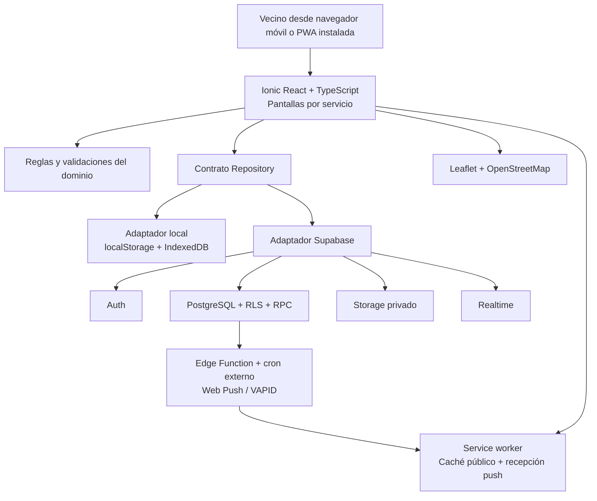

# Informe técnico: San Francisco Conecta

**Trabajo Práctico 5 · Arquitecturas Móviles · UTN Facultad Regional San Francisco**

Fecha: 21 de noviembre de 2026.

Referencia: _Guía de Trabajos Prácticos_, páginas 5–8, incluida en `referencias/Guia-TP.pdf`.

## Proyecto y alcance

San Francisco Conecta centraliza siete servicios municipales en una aplicación web móvil instalable. El prototipo académico permite completar los recorridos sin depender de APIs oficiales: los cambios se conservan en el navegador. Un segundo adaptador conecta las mismas pantallas a Supabase.

Los pagos, deudas, estaciones, alarmas y zonas son datos de demostración. Los teléfonos, el correo de Prensa y el asistente Tana proceden del directorio público del municipio, con enlaces a las fuentes. La aplicación no se presenta como un servicio oficial ni permite pagar obligaciones reales.

## Arquitectura elegida

**PWA e Ionic React.** Una sola base de código se ejecuta en navegadores móviles y escritorio; manifiesto y service worker permiten instalar y abrir la interfaz sin conexión después de la primera carga. Ionic aporta componentes, estructura de página y comportamiento móvil. No se genera una aplicación nativa ni se usa Capacitor.

**TypeScript y módulos.** Los tipos compartidos describen estaciones, obligaciones, reclamos, alarmas, sesiones y preferencias. Las pantallas se cargan por ruta y las reglas de tarifa, patente, cercanía y entrega de avisos se prueban de forma independiente.

**Contrato y adaptadores.** `Repository` evita que las pantallas dependan de una API concreta. La selección explícita por entorno facilita la demostración y permite sustituir fuentes sin reescribir la UI. Una conexión Supabase fallida muestra un error; no se reemplaza por información simulada sin avisar.

**Supabase.** Auth aporta identidad; PostgreSQL mantiene consistencia; RLS limita las filas por usuario; Storage almacena adjuntos privados y Realtime informa cambios. Los pagos demo y el estacionamiento se ejecutan mediante transacciones del servidor, con importes calculados allí. Un bloqueo por usuario evita crear dos estacionamientos activos simultáneos y un bloqueo del cedulón impide pagar dos veces.

**Leaflet/OpenStreetMap.** Se utiliza el mismo componente para estaciones, alarmas y zonas. Hay atribución visible, controles accesibles y listas con la misma información como alternativa al mapa. Las teselas requieren internet y no se descargan masivamente para uso sin conexión.

## Cobertura funcional de la ERS

| Requisito                             | Implementación y comprobación                                                                |
| ------------------------------------- | -------------------------------------------------------------------------------------------- |
| Bicicletas, disponibilidad y anclajes | Mapa/listado, simulador y cambios por Realtime en el adaptador remoto                        |
| Estaciones cercanas                   | Geolocalización por acción del usuario y distancia Haversine                                 |
| Problemas de bicicletas               | Formulario validado y reportes personales persistentes                                       |
| Cedulones y obligaciones              | Consulta, estados, total pendiente y emisión PDF sin validez fiscal                          |
| Pagos e historial                     | Confirmación explícita, transacción demo, comprobantes PDF y prevención de duplicados        |
| Vencimientos                          | Avisos con deduplicación y preferencias; cron remoto configurable                            |
| Reclamos con adjuntos                 | Categoría, dirección, validaciones de tipo/tamaño/cantidad, IndexedDB o bucket privado       |
| Seguimiento y búsqueda                | Estados recibido/en curso/resuelto, eventos, búsqueda y filtros                              |
| Atención al vecino                    | Directorio, llamadas, correo y WhatsApp publicados; fuentes visibles                         |
| Alarmas y suscripciones               | Mapa y estado, zonas de interés, ubicación opcional y radio 1/2/5 km                         |
| Alertas cercanas                      | Eventos locales o disparador SQL que aplica zonas/cercanía y categorías                      |
| Estacionamiento                       | Zonas y tarifas ilustrativas, patente, pago demo, reloj, extensión, finalización e historial |
| Notificaciones                        | Historial, lectura, enlace interno, categorías, zonas y frecuencia inmediata/24 h/pausa      |
| Push                                  | Suscripción/baja, service worker y función de entrega, pendientes de claves y despliegue     |

## Seguridad, privacidad y funcionamiento sin conexión

- El cliente utiliza una clave pública Supabase con RLS. No tiene permisos directos para modificar importes, pagos o estados administrativos.
- Las funciones de servidor comprueban `auth.uid()`, propiedad, rangos y estados. Se revoca el acceso a funciones internas y al disparador global de recordatorios.
- Adjuntos limitados a JPG/PNG/WebP/PDF, hasta tres archivos de 5 MB. Bucket privado y enlaces de descarga con vencimiento de 60 segundos.
- El service worker almacena archivos públicos de la aplicación, sin cachear respuestas de Supabase ni adjuntos personales.
- La ubicación se solicita por acción explícita y se puede quitar. En demo, el usuario es local y no se solicitan contraseñas.
- Las preferencias de notificación se evalúan al crear avisos y al entregar push. Los mensajes no pueden redirigir a un dominio externo desde la PWA.
- El funcionamiento offline completo corresponde al adaptador demo; Supabase necesita conexión para escribir. No hay una cola de mutaciones remotas que pueda confirmar operaciones no enviadas.

## Problemas encontrados y soluciones

| Problema                                                  | Solución                                                                                               |
| --------------------------------------------------------- | ------------------------------------------------------------------------------------------------------ |
| No se proporcionaron APIs ni credenciales oficiales       | Adaptador local operativo y adaptador remoto configurable; datos ilustrativos claramente identificados |
| Riesgo de registrar dos pagos o sesiones simultáneas      | Bloqueo de acciones en UI, transacciones y restricciones en PostgreSQL                                 |
| Adjuntos en almacenamiento local limitado                 | Binarios en IndexedDB; solo metadatos en localStorage                                                  |
| Recordatorios duplicados en cada actualización            | Claves de deduplicación por obligación/sesión y vencimiento                                            |
| Pestañas suspendidas no ejecutan temporizadores           | Cálculo desde timestamps persistentes y Edge Function/cron para el caso de app cerrada                 |
| Interfaz con contraste insuficiente en textos secundarios | Verificación automática por ruta y corrección de colores                                               |
| Diferencias de entorno y navegación directa               | Versiones fijadas, lanzador Windows, rutas SPA y configuración de redirección estática                 |

## Calidad y límites de aceptación

La validación combina pruebas de reglas, ejecución de las migraciones en PostgreSQL WASM, aislamiento entre dos usuarios y pruebas funcionales de navegador. El detalle reproducible y las mediciones se encuentran en `PRUEBAS.md`.

El despliegue alojado de Supabase (Auth, Storage HTTP y Realtime), un envío push real y la validación en teléfonos físicos requieren las credenciales y dispositivos correspondientes. La prueba SQL reproduce los contratos de Auth/Storage, pero no simula su infraestructura de red. El prototipo no declara cumplimiento legal ni certifica canales de emergencia.

La escalabilidad está contemplada en la separación por funcionalidades, índices por propietario, servicios administrados y carga por ruta. Para muchos usuarios se necesitan paginación, límites de carga, roles administrativos y una cola push con bloqueos. Estas mejoras no son necesarias para demostrar los recorridos del TP, pero sí para convertirlo en un servicio municipal operativo.
